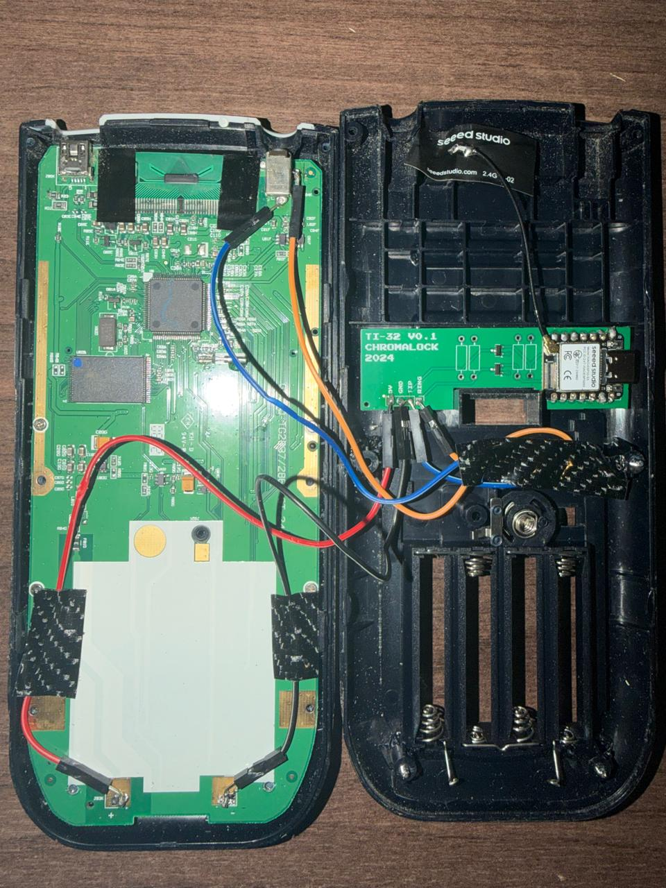
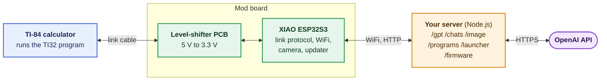
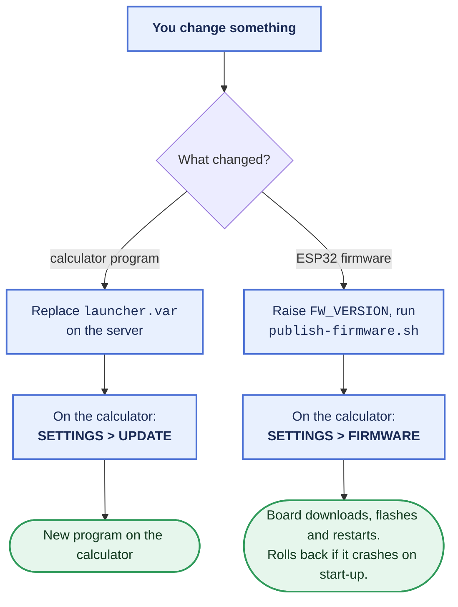

# TI84-AI-Mod

**Give a TI-84 calculator WiFi.** 
GPT chat, a camera view, a self-hosted server and wireless firmware updates, using an ESP32-S3.

[**Read the guide**](https://thellamainator.github.io/TI84-AI-Mod/) &nbsp;|&nbsp; [**Downloads**](https://thellamainator.github.io/TI84-AI-Mod/downloads) &nbsp;|&nbsp; [**Order the PCB**](https://thellamainator.github.io/TI84-AI-Mod/ordering-the-pcb)

> [!WARNING]
> **Use at your own risk, and read the rules where you use it.** A calculator with internet access can break exam and classroom rules. This project is for learning and tinkering. What you do with it is up to you and your school or exam board.

A modified version of the **TI-32** calculator project: an ESP32-S3 board wired to the link port of a TI-84, giving it WiFi. Based on the original TI-32 (GPL v3), whose author has since taken it down. See [Credits](#credits).

## What it does

| | |
| --- | --- |
| **Ask GPT** | Type a question on the calculator, read the answer a page at a time, and reply to carry on the conversation. |
| **Camera** | With a XIAO ESP32S3 **Sense**, take pictures and see a slow black-and-white live view. Optional but recommended. |
| **Chat, images and apps** | Chat between devices, pictures on the calculator screen, and programs downloaded from your server. |
| **Several WiFi networks** | The board remembers more than one network and joins the strongest one in range. |
| **Wireless updates** | **SETTINGS > UPDATE** replaces the calculator program, and **SETTINGS > FIRMWARE** replaces the ESP32 firmware, both over WiFi. No USB cable after the first flash. |
| **Your own server** | A small Node.js server does the internet work. You run it, and you hold the keys. |

## How it fits together

> Hover over a diagram on GitHub and use the controls in its corner to zoom and move it.

### Update paths

## Build it

| Step | Guide |
| --- | --- |
| **1. Order the PCB** | [Ordering the PCB](https://thellamainator.github.io/TI84-AI-Mod/ordering-the-pcb): every file to upload is in [`pcb/jlcpcb/`](pcb/jlcpcb) |
| **2. Open the calculator and wire it** | [Wiring and parts](https://thellamainator.github.io/TI84-AI-Mod/wiring): disassembly, soldering and the wiring diagram |
| **3. Run the server** | [Server setup](https://thellamainator.github.io/TI84-AI-Mod/server-setup) |
| **4. Flash the ESP32 and use it** | [Flash and use it](https://thellamainator.github.io/TI84-AI-Mod/firmware-setup): the first transfer, the menus and troubleshooting |

Want the files first? **[Downloads](https://thellamainator.github.io/TI84-AI-Mod/downloads)** has the PCB files, the sketch, the server and the settings templates.

## What's in this repository

| Folder | Contents |
| --- | --- |
| [`esp32/`](esp32) | The Arduino sketch, camera pins, the compiled calculator program, `secrets.example.h` and `publish-firmware.sh` |
| [`server/`](server) | The Node.js server |
| [`pcb/`](pcb) | KiCad project, gerbers, and the ordering files in `pcb/jlcpcb/` |
| [`source/`](source) | The original tools for converting images and calculator programs |
| [`docs/`](docs) | The documentation site (built with VitePress) and the original project's docs |

## Keep your secrets out of git

The sketch needs a `secrets.h` (WiFi details, server address, update password) and the server needs a `.env` (OpenAI key, update password). Copy `esp32/secrets.example.h` to `secrets.h` and `server/.env.example` to `.env`, then fill them in. Both are in `.gitignore`. **Never commit them.**

## Known limits

- The calculator link is slow. A picture refreshes about once every second or two at best, and each answer page holds 100 characters.
- Lowercase letters get cut from the end of text typed on the calculator, so use capitals.
- The server speaks plain HTTP. Read the security notes in [Server setup](https://thellamainator.github.io/TI84-AI-Mod/server-setup) before exposing it to the internet, and set a spending limit on your OpenAI account.

## Credits

This is a modification of the original **TI-32** project, released under the **GNU General Public License v3**. The GPL lets everyone who received the code keep, modify and share it, as long as the licence and notices stay. See [LICENSE](LICENSE) and [NOTICE.md](NOTICE.md) for what came from the original and what changed here.

The calculator disassembly steps are adapted from [iFixit](https://www.ifixit.com/Guide/TI-84+Plus+Disassembly/117983) (CC BY-NC-SA). The calculator link code uses **ArTICL** by Kerm Martian (Cemetech), installed separately.

AI was used in the development of this project. It helped write and revise code, scripts and documentation, and the results were tested and reviewed by the author.

## Licence

GNU GPL v3. See [LICENSE](LICENSE).
