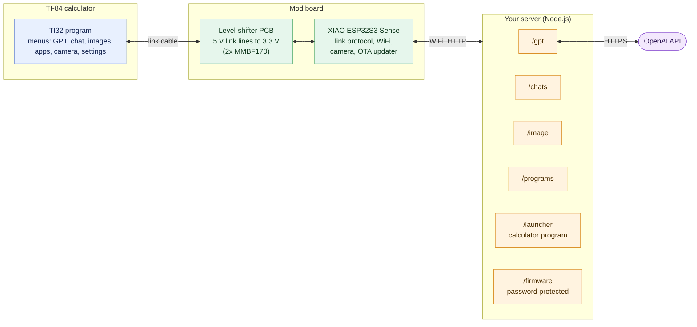
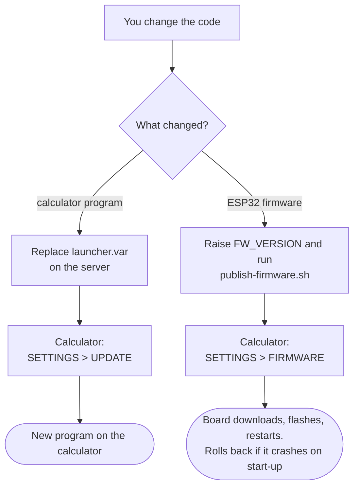

# Overview

A modified version of the **TI-32** calculator project: an ESP32-S3 board wired to the link port of a TI-84 graphing calculator, giving it WiFi. It adds a camera view, chat with GPT (with replies), several WiFi networks, a self-hosted server, and **wireless firmware updates**.

Based on the original TI-32 project, which is licensed under the GPL v3. See [Credits and licence](/credits).

> **Use at your own risk, and read the rules where you use it.** A calculator with internet access can break exam and classroom rules. This repository is for learning and tinkering. What you do with it is up to you and your school or exam board.

## What it does

- Connects a TI-84 to your WiFi through an ESP32 on the link port.
- **ASK GPT**: type a question on the calculator, read the answer a page at a time, reply to carry on the conversation.
- **Chat** between devices, **images** shown on the calculator screen, and **apps** (calculator programs) downloaded from your server.
- **Camera**: with a XIAO ESP32S3 **Sense**, take pictures and show a slow live view in black and white. Optional.
- **SETTINGS > UPDATE** replaces the calculator's program from your server.
- **SETTINGS > FIRMWARE** replaces the ESP32's firmware over WiFi, so you don't need a USB cable after the first flash.
- Remembers more than one WiFi network and joins the strongest one in range.

## How it fits together

### Update paths

- The **PCB** (`pcb/`) shifts the calculator's 5 V link signals to the ESP32's 3.3 V.
- The **sketch** (`esp32/`) talks the calculator link protocol and your server.
- The **server** (`server/`) does what the ESP32 can't: it calls OpenAI, stores chat, and serves images, programs, the calculator launcher program and firmware.

## Setting it up

Want the files first? See the [Downloads](/downloads) page.

1. [Order the PCB](/ordering-the-pcb) (all files are in `pcb/jlcpcb/`)
2. [Build the hardware](/wiring)
3. [Run the server](/server-setup)
4. [Flash the ESP32 and put the program on the calculator](/firmware-setup)

## Repository layout

| Folder | Contents |
| --- | --- |
| [`esp32/`](https://github.com/TheLlamainator/TI84-AI-Mod/tree/main/esp32) | The Arduino sketch, camera pins, the compiled calculator program (`launcher.h`), `secrets.example.h` and `publish-firmware.sh`. |
| [`server/`](https://github.com/TheLlamainator/TI84-AI-Mod/tree/main/server) | The Node.js server. |
| [`pcb/`](https://github.com/TheLlamainator/TI84-AI-Mod/tree/main/pcb) | KiCad project, gerber files and pictures of the level-shifter board. |
| [`source/`](https://github.com/TheLlamainator/TI84-AI-Mod/tree/main/source) | Original tools for converting images and calculator programs, and the original `LAUNCHER.8xp` sources. |
| [`docs/`](https://github.com/TheLlamainator/TI84-AI-Mod/tree/main/docs) | Guides, plus the original project's documentation. |

## Your secrets stay out of git

The sketch needs a `secrets.h` (WiFi details, server address, update password) and the server needs a `.env` (OpenAI key, update password). Both are listed in `.gitignore`. Copy `esp32/secrets.example.h` to `secrets.h` and `server/.env.example` to `.env`, then fill them in. **Never commit them.**

## Known limits

- The calculator link is slow. Pictures refresh about once a second or two at best, and each answer page holds 100 characters.
- Lowercase letters get cut from the end of text typed on the calculator, so capitals are safest.
- The server speaks plain HTTP. Read the security notes in [Server setup](/server-setup) before exposing it to the internet, and set a spending limit on your OpenAI account.
- `source/programs/LAUNCHER.8xp.txt` is the **original** calculator program. The program actually used by this mod is `esp32/launcher.h` and `server/launcher/launcher.var`, which add the CAMERA and FIRMWARE menu entries.
